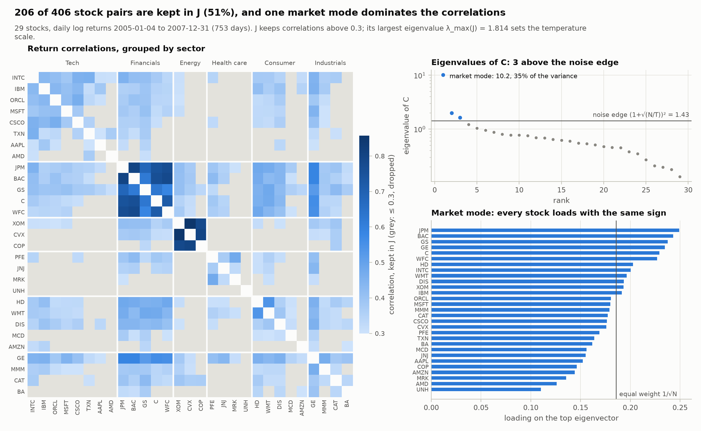
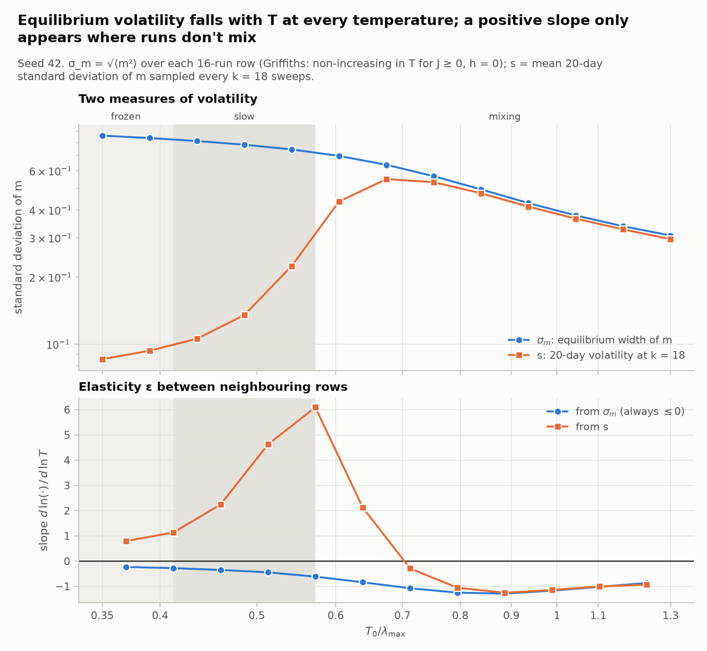
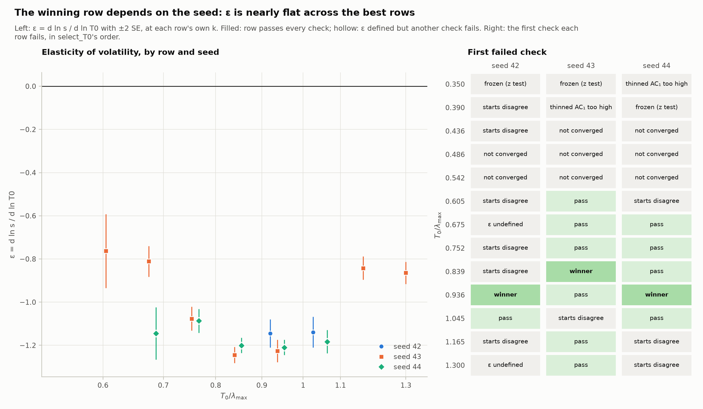
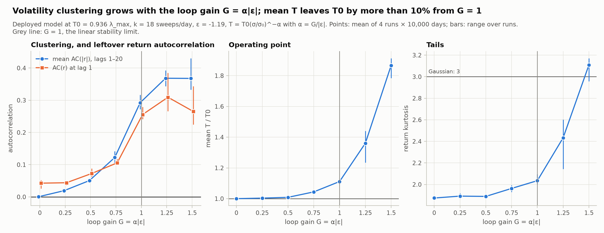
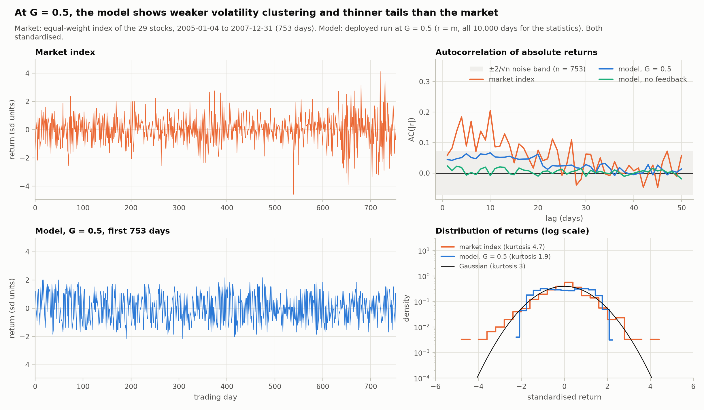
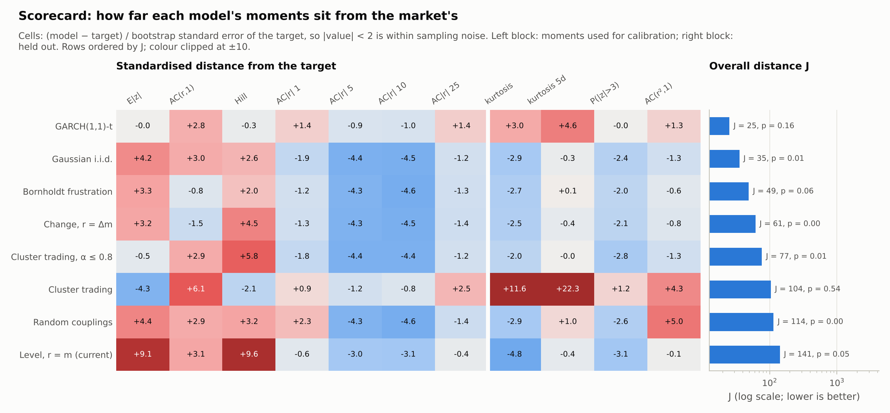
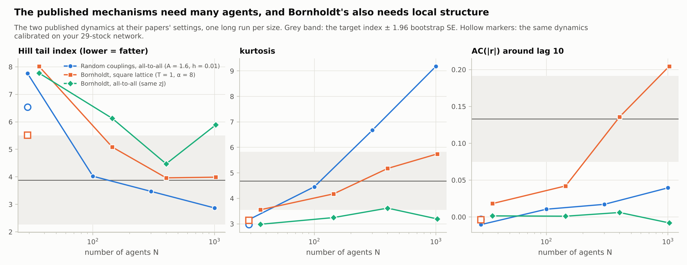
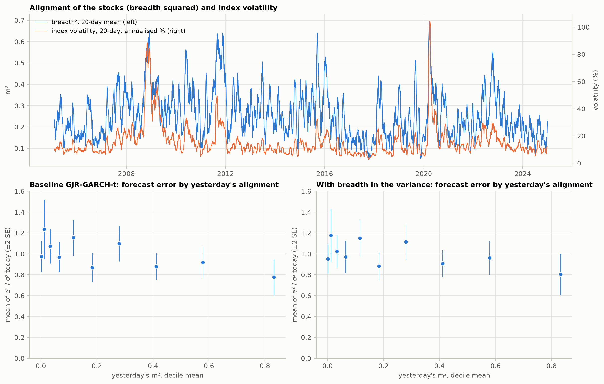

# Financial Ising Model

A statistical-physics model of a stock market. Each of N stocks is an Ising spin (s = +1 buy, −1 sell sentiment), coupled to the others through a network built from empirical return correlations. The spins evolve under single-spin Metropolis dynamics at temperature T, and the market return is proportional to the magnetisation m = Σ s_i / N. A volatility-feedback rule lets recent volatility move the temperature.

The repository contains the model, a calibration pipeline that picks the baseline temperature T0 and the time scale k (Monte Carlo sweeps per trading day) from pilot simulations, and a compiled harness for running the calibrated model and measuring stylised facts.

## Status (October 2026)

- The calibration pipeline runs end to end on real data from Yahoo Finance: 29 US large caps over 2005–2007, and 100 over 2005–2024.
- The calibrated model with volatility feedback produces volatility clustering on the real network, but the original goal of reproducing fat tails is out of reach in this setup (see *Findings*).
- Five other ways of turning spins into returns, taken from the literature, were compared against the index on the same network, on 29 stocks and then on 100 stocks over 20 years. None of them produces market-like tails, and a GARCH(1,1)-t beats all of them (see *Other ways to turn spins into returns*).
- A direct test on the 100-stock data finds that market breadth, the data's own magnetisation, does not improve volatility forecasts out of sample (see *Does alignment predict volatility?*).
- The figures below are reproduced by `scripts/make_figures.py`, `scripts/compare_return_models.py` and `scripts/garch_x_breadth.py` from the frozen data.
- The project is moving toward **early-warning signals for regime flips**, using the model as a lab where every flip's timing and cause are known (see *Next steps*).

## Findings so far

The first five subsections use the frozen 2005–2007 data for 29 stocks. The return-model comparison and the breadth test use 100 stocks over 2005–2024. Temperatures are quoted as multiples of λ = λ_max(J).

### The data: one market mode and two tight sectors



- **Network.** 753 trading days; J keeps 206 of 406 pairs (50.7%) and λ_max(J) = 1.814. The mean pairwise correlation is 0.32, so the 0.3 cut-off sits right at the typical correlation.
- **One market mode.** It carries 35% of the variance (λ₁ = 10.2), and every stock loads on it with the same sign; financials and GE load most.
- **Little else above noise.** Only two more eigenvalues clear the random-matrix noise edge of 1.43: an energy mode (λ₂ = 2.0) and a financials-versus-tech mode (λ₃ = 1.65).
- **Uneven connectivity.** Financials (average correlation 0.71) and energy (0.81) are the tight blocks; tech averages 0.35 and health care 0.28. UNH has no edges at all.

### The volatility feedback has to lower T when volatility rises



- For ferromagnetic couplings (J ≥ 0) at h = 0, Griffiths' second inequality makes ⟨m²⟩ non-increasing in T. So in any well-mixed run, volatility *falls* as T rises (ε = d ln σ / d ln T ≤ 0).
- **On the real network:**
  - The equilibrium width σ_m falls at every temperature in the scan, from 0.86 to 0.31.
  - The 20-day volatility s rises with T only in rows that don't mix (local slopes up to +6). There it measures fluctuations inside a single well: s/σ_m = 0.10–0.30.
  - From 0.75 λ up, s/σ_m ≈ 0.96 and the two slopes agree.
  - The positive ε the original pipeline required exists only in that artefact.
- **The old rule could only damp.** T = T0(1 + α σ/σ0) therefore could only damp volatility, and it also shifted the operating point above T0.
- **The new rule.** The model now uses **T = T0 (σ/σ0)^(−α)**: higher volatility means lower T, i.e. more herding. The loop gain is G = α|ε|.

### Calibration on real data



- **Three regimes across the T0 scan** ([regime map](docs/figures/fig2_regimes.png), [example runs](docs/figures/fig4_traces.png)):
  - frozen in one well at 0.35–0.39 λ;
  - too slow to converge at 0.44–0.54 λ (τ_int of 500–900 sweeps, against a cap of 167);
  - mixing from 0.60 λ.
- **The clock depends strongly on T0.** One trading day is 432 sweeps at 0.60 λ, 18 at 0.94 λ and 7 at 1.30 λ.
- **The winning row changes with the seed:** 0.936 λ in seeds 42 and 44, 0.839 λ in seed 43.
  - ε lies between −1.08 and −1.25 for every row from 0.75 λ to 1.05 λ, so noise of 0.01–0.03 decides which one wins.
  - The most common failure is the check that random and all-up starts agree: 10 of the 25 failed rows across the three seeds. Seed 42 alone fails it on 6 of 13 rows, 4 of them in the mixing regime.
- **Recommended:** T0 = 0.936 λ = 1.699, k = 18 sweeps/day, σ0 = 0.415, ε = −1.19. It is the only row that passes in all three seeds.

### Deployment on the real network: clustering, with two artefacts



- **Clustering grows with the loop gain** (mean AC(|r|) over lags 1–20):

  | G = α\|ε\| | 0.25 | 0.5 | 0.75 | 1 |
  |---|---|---|---|---|
  | mean AC(\|r\|), lags 1–20 | 0.019 | 0.051 | 0.122 | 0.292 |

- **Stability.** With ε = −1.19, linear stability needs α < 0.84 (G < 1).
  - The operating point holds up to G = 0.75 (mean T/T0 = 1.04).
  - Past G = 1 it runs away: mean T/T0 is 1.11 at G = 1, 1.36 at 1.25 and 1.87 at 1.5.
- **Artefact 1: lag-1 return autocorrelation grows with the clustering.** It is 0.073 at G = 0.5 and 0.26 at G = 1, against −0.10 for the index. Feedback slows the dynamics, so the clock k chosen at α = 0 is too short.
  - Doubling k to 36 removes it at G ≤ 0.75 and leaves the clustering unchanged: AC(r, 1) falls from 0.066 to 0.006 at G = 0.5 (mean AC(|r|) stays 0.053), and from 0.125 to 0.028 at G = 0.75 (`scripts/k_under_feedback.py`).
  - At G = 1 it persists even at k = 144. T then spends about a quarter of days below 0.65 λ, near the slow regime, where m tends to keep its sign from one day to the next.
- **Artefact 2: the clustering has a fixed memory.** In the model, AC(|r|) is flat out to lag 20 and then drops, because the feedback averages over a 20-day window. The market's AC(|r|) decays gradually instead.

### No fat tails



- **Model vs index.** The equal-weight index of the 29 stocks has kurtosis 4.7 and mean AC(|r|) 0.10. The model at G = 0.5 has kurtosis 1.9 and mean AC(|r|) 0.05; without feedback it shows no clustering at all.
- **Returns ∝ m are capped.** Since |m| ≤ 1, a standardised return can't exceed about 1/σ_m ≈ 2.3 standard deviations at the selected T0, while the index has days beyond 4.
- **m is two-humped even when mixing** ([fig. 4](docs/figures/fig4_traces.png)), which pushes kurtosis below 3. The Binder ratio, which equals the return kurtosis, is 1.17–2.46 across the mixing rows.
- **Kurtosis passes 3 only after runaway**, at G = 1.5, when T has drifted 87% above T0.
- **Part of the index's tails and clustering is one regime shift.** Its daily volatility was 0.65–0.77% in each half-year until mid-2007 and 1.26% from July 2007. Its worst day is 27 February 2007, at −4.5 standard deviations.
- This is a limit of how returns are defined in the model, not of the calibration.

### Other ways to turn spins into returns



**The test.**
- Five return mechanisms from the literature run on the same network.
- Each is calibrated to the equal-weight index by the method of simulated moments (Franke & Westerhoff 2012):
  - nine moments: E|z|, AC(r, 1), the Hill tail index, and AC(|r|) at lags 1, 5, 10, 25, 50 and 100 (lags 50 and 100 only for targets of 2,500 days or more);
  - each weighted by its own block-bootstrap variance, with blocks of 251 days (a twentieth of the sample);
  - two-stage grid search: the best three grid points are re-scored on longer runs.
- Four more moments are held out: kurtosis, 5-day kurtosis, P(|z| > 3) and AC(r², 1).
- Two yardsticks: a GARCH(1,1)-t fitted by maximum likelihood, and an i.i.d. Gaussian.

**The data.** 100 US large caps, 2005–2024 (5,032 days; `universes/tickers_us_large_cap.csv`). The index has kurtosis 18.6 and a Hill index of 2.4 ± 0.4. J keeps 4,301 of 4,950 pairs (87%) at the 0.3 threshold, with λ_max(J) = 9.02. The calibration picks T0 = 0.839 λ in two of three seeds, with k = 248 sweeps a day and ε = −3.18. So the feedback is linearly stable only for α < 0.31. At that T0, m is two-humped (Binder ratio 1.26).

| rank | model | mechanism | J | p |
|---|---|---|---|---|
| 1 | GARCH(1,1)-t | statistical benchmark, 4 parameters fitted by maximum likelihood (Bollerslev 1986, 1987) | 15 | 0.62 |
| 2 | Random couplings | Krawiecki, Hołyst & Helbing (2002) | 175 | < 0.025 |
| 3 | Change, r = Δm | market clearing against fundamentalists (Kaizoji et al. 2002) on our dynamics, 1 sweep a day | 184 | < 0.025 |
| 4 | Bornholdt frustration | global minority-type coupling −α_B s_i \|M\|, r = ΔM (Bornholdt 2001; Kaizoji et al. 2002) | 185 | < 0.025 |
| 5 | Level, r = m (current) | excess demand moves the price; T drifts to 5.4 T0 | 211 | < 0.025 |
| 6 | Cluster trading | Cont & Bouchaud (2000) activity on Fortuin–Kasteleyn clusters (our combination); T drifts to 7.8 T0 | 214 | < 0.025 |
| 7 | Cluster trading, α ≤ 0.8 | the same with weaker feedback; T drifts to 2.4 T0 | 215 | < 0.025 |
| 8 | Gaussian i.i.d. | null model, no parameters | 225 | < 0.025 |

**Reading the table.**
- **J** is the weighted distance from the index's moments; lower is better.
- **p** is the share of model samples of the index's length that sit further from the model's own long-run moments than the index does. A high p means the index is a plausible draw from the model. The run used `--quick` (40 samples per model), so p < 0.025 means none of them did.
- The run was calibrated with the earlier weighting (the inverse of the full bootstrap covariance) and re-scored with each moment's own variance (`--replot --weights diag`). The parameters are the ones chosen under the earlier weighting.
- Full tables are written to `results/return_models_us100/rescored_diag/return_models.md`.

**What it shows.**
- **Only GARCH survives.** It is the one model the index is a plausible draw from (p = 0.62). It matches 8 of the 9 fitted moments within 1.2 standard errors, including AC(|r|) out to lag 100, with a + b = 0.992. It misses the negative lag-1 autocorrelation (0.01 vs −0.11) and overshoots kurtosis (37 vs 18.6) and 5-day kurtosis (42 vs 13).
- **No spin mechanism does much better than an i.i.d. Gaussian.** Their J ranges from 175 to 215, against 225 for the Gaussian. Their Hill indices are 5.2–6.2 against the index's 2.4, and kurtosis stays at or below 3.7. From lag 5 on, their AC(|r|) is at most 0.03, against 0.40 for the index.
- **Both r = ΔM mappings match the negative lag-1 autocorrelation:** −0.10 (change) and −0.09 (Bornholdt) against −0.11, as Bornholdt's did on 29 stocks.
- **Random couplings cluster for a day or two.** AC(|r|) at lag 1 is 0.25 against the index's 0.39, but it is gone by lag 5.
- **The level and cluster mappings ran away.** Their α grid was sized for the 29-stock ε of −1.19. Here the calibrated α of 1.0 and 1.2 means a loop gain G of 3.2 and 3.8, so T settles at 5.4 and 7.8 T0. Deep in the disordered phase, the returns are Gaussian (kurtosis 3.0). `compare_return_models.py` now sets these grids in G = α|ε| instead, but these three models haven't been rerun on 100 stocks.
- **The weighting matters on a long target.** With the full-covariance weighting, the level mapping ranks first (J = 112, against 116 for GARCH), even though it misses all nine moments by 2 to 8 standard errors. The nine moments' bootstrap correlation matrix has condition number 1,299, and one direction (calm against turbulent resamples) carries 72% of the variance. A model that misses along that direction is barely penalised. On 29 stocks the condition number is 19.

**On 29 stocks** (2005–2007, 753 days) the ranking is similar under either weighting: GARCH first and the level mapping last. Bornholdt's dynamics was the best mechanism there, with the tail index within 2 standard errors (5.5 vs 3.9). Cluster trading only got fat tails by running away (Hill 2.2, kurtosis 11.5 at T = 3.1 T0).



**Why the spin models fall short: system size and network structure.** Run at their papers' settings, both published dynamics reproduce the papers at their own scale:
- Random couplings reach a Hill index of 2.9–3.1 at N = 1000; the paper's analytic value is 2.89.
- Bornholdt's lattice model reaches a Hill index of about 4 and AC(|r|) ≈ 0.2 at lag 10 with N = 1024.

Both effects fade as N shrinks. Bornholdt's clustering also disappears on an all-to-all network, even at N = 1024. The 100-stock network is both small and close to all-to-all (87% of pairs connected). Even at N = 1000, the published dynamics reach kurtosis 7.6 at most, against 18.6 for the 2005–2024 index.

More figures: [tail distributions](docs/figures/figR1_tails.png), [AC(|r|) by model](docs/figures/figR2_clustering.png), [sample paths](docs/figures/figR4_paths.png).

**Caveats.** The index's tails come mostly from 2008 and 2020. The universe has survivorship bias: every stock in it is still listed today.

**Not tested:** threshold (three-state) traders (Iori 2002). Their fat tails rely on trade frictions and a volume-dependent price impact, which would need cash and inventory accounting this model doesn't have.

### Does alignment predict volatility?



In the model, aligned spins mean herding. In the data, each stock's spin on a given day can be read as the sign of its return. The magnetisation m is then market breadth: the share of stocks up minus the share down.

**The test** (`scripts/garch_x_breadth.py`) asks whether yesterday's m² predicts the variance of the 100-stock equal-weight index, once a standard volatility model is already in place:
- **Baseline:** GJR-GARCH(1,1) with Student-t innovations and an AR(1) mean. GJR lets volatility rise more after falls (Glosten, Jagannathan & Runkle 1993).
- **Added terms:** γ m² from the previous day in the variance equation and, separately, δ times a robust cross-sectional dispersion D.
- **The main test is breadth given dispersion.** An equal-weight index of N stocks keeps some stock-specific risk, which rises with dispersion, and low breadth partly measures that. On simulated panels where breadth had no effect, breadth on its own came out significant in 12% of runs at the 5% level. Given dispersion, the rate was 5%, and a real effect of γ = 0.15 was found in 92% of runs.
- **In sample:** likelihood-ratio and robust (sandwich) Wald tests.
- **Out of sample:** fitted on 2005–2014, with one-day variance forecasts over 2015–2024 compared by QLIKE loss (Patton 2011) and a Diebold–Mariano test with Newey–West standard errors.

| question | in sample | out of sample: QLIKE gain (DM t) |
|---|---|---|
| breadth alone | γ = −0.124, LR = 23.8 (p < 0.001) | −0.011 (−1.44) |
| dispersion alone | δ = 0.028, LR = 29.5 (p < 0.001) | −0.005 (−0.51) |
| breadth given dispersion | γ = −0.068, robust z = −2.66, LR = 7.2 (p = 0.007) | −0.006 (−0.96) |
| asymmetry g (sanity check) | LR = 131 | +0.023 (2.03, p = 0.04) |

A positive gain means the larger model forecasts better.

**What it shows.**
- **In sample, breadth matters even given dispersion, but with the opposite sign to herding.** After strongly aligned days, variance is lower than GJR predicts. The baseline's forecast errors show it directly: on the tenth of days with the highest m², realised variance averages 0.78 of the forecast (standard error 0.09). One standard deviation of m² lowers next-day variance by about 3% of its median (5% without the dispersion term).
- **A likely reading:** m² is close to 1 after big moves, so a negative γ softens GJR's quadratic response to large shocks. That is a correction to the shape of the news-impact curve, not evidence about herding.
- **Out of sample, neither breadth nor dispersion helps.** Both make the forecasts slightly worse, though not significantly. The asymmetry term, by contrast, does improve them (DM t = 2.03). So breadth carries no usable information about next-day volatility beyond a standard volatility model.

## Repository layout

```
src/ising_market/model.py   model, calibration pipeline, deployment harness
scripts/calibrate_real.py   downloads the data once, freezes it in data/, calibrates seeds 42-44
scripts/make_figures.py     the figures and numbers summary used in this README
scripts/compare_return_models.py   the return-model comparison (figures figR1-figR5, tables)
scripts/k_under_feedback.py        the check of the clock k under feedback
scripts/garch_x_breadth.py  the breadth test: does alignment predict index volatility?
scripts/freeze_data.py      downloads, cleans and freezes a larger ticker universe
universes/tickers_us_large_cap.csv  202 US large caps in 11 sectors (101 marked core)
docs/figures/               committed copies of the figures
pyproject.toml, uv.lock     dependencies (managed with uv)
```

`data/` and `results/` are git-ignored; regenerate them by rerunning the scripts. A fresh Yahoo download can differ slightly from an earlier one, so keep a frozen copy of the returns for anything you need to reproduce exactly.

## Setup

```bash
uv sync
```

This installs Python 3.12 (see `.python-version`), numpy, scipy, pandas, networkx, matplotlib, numba and yfinance.

## Running the calibration

```bash
uv run python -m ising_market.model
```

This downloads the 30 tickers (TWX fails and is dropped) and builds J. It then runs the T0 scan: 13 temperatures × 8 seeds × 2 starts = 208 pilot runs of 50,000 sweeps each after a 10,000-sweep burn-in. Finally it prints the selection report. The compute part takes about half a minute on a laptop.

The command-line flags (`--mode`, `--alpha`, …) are parsed but not used yet.

## Reproducing the figures

```bash
uv run python scripts/calibrate_real.py   # once: download, freeze data/, calibrate seeds 42-44
uv run python scripts/make_figures.py     # about a minute: results/figures/*.png and summary.md
uv run python scripts/compare_return_models.py   # about 5 minutes: results/return_models/
mkdir -p docs/figures && cp results/figures/fig*.png docs/figures/
```

`make_figures.py` reruns the calibration for seeds 42–44 and picks the row that passes in the most seeds. It then runs the deployed model at seven loop gains (4 runs × 10,000 days each). `compare_return_models.py` reads that run's `figdata.pkl` (network, recommended row and the index) and needs no download. Both scripts accept `--quick` for shorter runs to check the pipeline, and `--replot` to redraw from the saved numbers without simulating.

### A larger, longer dataset

The 29-stock, three-year sample is too small to separate the return models. Its tail index has a bootstrap standard error of about 0.8, and the network is too small for the published mechanisms to produce fat tails. `universes/tickers_us_large_cap.csv` lists 202 US large caps in the 11 GICS sectors (8 to 22 per sector), all listed since before 2005 and still listed. The 101 marked `core` are a smaller subset with 6 to 10 per sector. A sample from 2005 to 2024 has about 5,000 days and covers 2008, 2011, 2020 and 2022. On the core list it cut the tail index's standard error from about 0.8 to 0.44. EQR returned no data (Equity Residential is merging with AvalonBay), so the run in this README has 100 stocks.

```bash
uv run python scripts/freeze_data.py --core-only          # data/rets_us100_2005_2024.pkl etc.
uv run python scripts/make_figures.py --rets data/rets_us100_2005_2024.pkl \
    --J data/J_us100_2005_2024.npy --sectors data/sectors_us100_2005_2024.csv \
    --out results/figures_us100
uv run python scripts/compare_return_models.py --figdata results/figures_us100/figdata.pkl \
    --out results/return_models_us100 --quick --jobs 4
uv run python scripts/compare_return_models.py --out results/return_models_us100 --replot \
    --weights diag                                        # re-score a run made with --weights full
uv run python scripts/garch_x_breadth.py --rets data/rets_us100_2005_2024.pkl   # about 20 s
cp results/return_models_us100/rescored_diag/figR*.png results/garch_x/garch_x.png docs/figures/
```

`freeze_data.py` drops tickers that start late, end early or have gaps, forward-fills gaps of up to 3 days, and lists every single-day move above 25% in `data/outliers_<tag>.csv`. Check that list for spin-offs Yahoo didn't adjust. It writes a report, `data/freeze_<tag>.txt`, with network density at several thresholds. The tag in the file names is the number of tickers kept, so it can differ from 101. For targets of 2,500 days or more, `compare_return_models.py` also fits AC(|r|) at lags 50 and 100, and uses bootstrap blocks of a twentieth of the sample. It prints a run-time estimate before it starts. Run time grows with N² and with the calibrated clock k. On 100 stocks, k = 248 sweeps a day, and the `--quick` comparison took 13 hours. `--jobs` runs models in parallel processes, and `--add` adds models to an existing run, e.g. to run the slow ones later. `--weights full` uses the inverse of the full bootstrap covariance instead of each moment's own variance. With `--replot`, `--weights` re-scores a saved run without re-calibrating. `make_figures.py` builds J at `--threshold` when the `--J` file doesn't exist yet, and stops if an existing J was built at a different threshold. The list has survivorship bias: every stock in it is still listed today.

## Using the model from Python

```python
from ising_market.model import (fetch_market_data, build_empirical_J, calibrate_parameters,
                                simulate_deployed, stylised_facts)

rets, tickers = fetch_market_data(["AAPL", "MSFT", "JPM", "XOM"], "2005-01-01", "2008-01-01")  # your list
J, C = build_empirical_J(rets)
cal = calibrate_parameters(rets, J, n_pilot=50_000, n_burn=10_000, seed=42)

if cal["T0"] is not None:
    sim = simulate_deployed(J, cal["T0"], cal["k"], alpha=0.4, sigma0=cal["sigma0"], n_days=10_000)
    print(stylised_facts(sim["r"]))     # kurtosis, JB p-value, t dof, AC(r), AC(|r|)
```

## How the calibration works

1. **Network.** J_ij = corr_ij where corr_ij > 0.3, rescaled so the mean non-zero coupling is 0.1. λ_max(J) sets the scale of the mean-field crossover, and the T0 grid runs from 0.35 λ to 1.30 λ.
2. **Pilot runs** at α = 0 and h = 0, from random and all-up starts, using a compiled (numba) Metropolis kernel.
3. **Per-run statistics:**
   - RMS magnetisation σ_m and Binder ratio R (the return kurtosis, since returns ∝ m);
   - integrated autocorrelation time τ_int, using Sokal's automatic window with c = 6, so a run counts as converged only if τ_int < n/300;
   - a zero-mean z test.
4. **Per-temperature row:**
   - thinning interval k = ⌈3 · p75(τ_int)⌉ over the converged runs;
   - pooled signed lag-1 autocorrelation of the thinned series, which must satisfy |mean| + 2 SE ≤ 0.10;
   - rolling volatility s at k;
   - an equilibration check comparing random and all-up starts.
5. **Elasticity** ε = d ln s / d ln T0, measured at the row's own k. It's an OLS slope over that row and its neighbours, using only rows that pass the run-quality checks.
6. **Selection.** A row must pass every check and have ε + 2 SE < 0; the winner is the row with the most negative upper bound. `calibrate_parameters` returns `T0`, `k` (use as `sweeps_per_step`) and `sigma0`.
7. **Deployment.** k sweeps per day, with T = T0 (σ/σ0)^(−α) updated daily from the standard deviation of the last 20 daily values of m.

## Known limitations

- **The equilibration check is noisy.** It compares 8 runs against 8 with a 2σ test and falsely fails about 30% of well-mixed rows. Together with the flat ε near its optimum, this is why the selected T0 depends on the seed.
- **No fat tails.** Returns ∝ m are bounded (about ±2.3 standard deviations at the selected T0) and two-humped (see *Findings*).
- **Feedback artefacts.** Clustering comes with positive lag-1 return autocorrelation unless k is re-chosen under feedback, and its memory stops at the 20-day window.
- **The 100-stock comparison ran with the old settings.** It was calibrated with the full-covariance weighting and an α grid sized for the 29-stock network, so the level and cluster mappings were calibrated with runaway feedback. The scripts now default to diagonal weighting and loop-gain grids. Those three models need a rerun, which takes about 13 hours at k = 248.
- **Survivorship bias.** Every stock in the 100-stock universe is still listed today.
- **numba cache.** The on-disk cache is tied to the name the module was imported under. If you import `model.py` both as a top-level `model` and as `ising_market.model`, you'll get `ModuleNotFoundError: No module named 'model'`. Delete the `*.nbi` and `*.nbc` files under `src/` (`find src \( -name "*.nbi" -o -name "*.nbc" \) -delete`), or set `cache=False` (compiling costs under a second per kernel).
- **Unfinished pieces of the old code:**
  - the CLI flags do nothing yet;
  - the `plot_*` helpers predate the calibration: they use one sweep per step and no calibrated σ0;
  - κ is not calibrated (`target_vol` is unused).
- **No tests in the repository yet.** `pyproject.toml` points pytest at `tests/`, which is currently git-ignored.

## Next steps

### 1. Early-warning signals for regime flips (main direction)

The question is when indicators computed from market data can warn of a regime flip, and whether a detector trained on simulations works on real APAC index data. The model can produce each kind of transition with known labels:

- noise-driven tunnelling at fixed T;
- a slow drift in the news field h toward the point where the current state disappears;
- an approach to the critical point;
- a sudden shock.

A pilot on the synthetic network found:
- **No warning for noise-driven flips or shocks:** ROC-AUC 0.50–0.54 for every indicator.
- **Drift-driven flips are detectable, but weaker as the drift slows:** variance AUC goes from 0.96 to 0.79.
- **The strongest signal is a trivial one:** how far m has already sagged toward the barrier (AUC 0.93–0.99).
- **Lag-1 autocorrelation is weak** (≤ 0.64).

So any early-warning claim has to beat a drawdown-style baseline, not just chance.

Planned phases, each ending in a go/no-go check:
1. A simulation lab producing a "warnability map": AUC as a function of drift rate and T, net of the level baseline, reproduced on three networks.
2. Network-resolved indicators: sector magnetisations, the top eigenmode of J, mean pairwise spin correlation.
3. A detector trained on simulations: gradient boosting first, a sequence model only if it does better.
4. A single pre-registered test on APAC index data (Hang Seng, Nikkei, KOSPI, …), with event rules fixed in advance and placebo windows.
5. A write-up.

First concrete steps: load the frozen J; re-pick the pilot temperatures on the real network, where flip rates differ from the synthetic one; then rerun the pilot.

### 2. Calibration loose ends

- Select T0 by pooling seeds (survival frequency and mean ε per row) instead of taking one seed's best row.
- Fix the equilibration test: a Bonferroni threshold across its three statistics, or more seeds per start.
- Under feedback, use k = 36 (twice the calibrated clock) for G ≤ 0.75, or re-derive k from τ_int measured under feedback.
- Replace the 20-day volatility window with an EWMA or several windows, so the clustering decays instead of stopping at 20 days.
- Rerun the level and cluster mappings on 100 stocks with the loop-gain grid.
- Compare the model with the index both with and without the second half of 2007.
- Add pytest tests: bit-identical pilots, FFT autocorrelation matching the direct method, and a seed-pinned calibration snapshot.
- Set `cache=False` on the numba kernels, wire up the CLI, update the `plot_*` helpers, and calibrate κ against index volatility.

### 3. Possible extensions

- Fit couplings by inverse Ising (pseudo-likelihood) instead of thresholding correlations, so the market's own distance from criticality can be estimated.
- Model crashes as avalanches in a driven random-field Ising model, which is a known route to heavy tails.
- Use a kinetic (asymmetric) Ising model to study directed influence across APAC time zones.
- Run Bornholdt's frustration dynamics on a sparse network of a larger universe, such as a minimum spanning tree (Mantegna 1999) or a planar maximally filtered graph (Tumminello et al. 2005). That gives it both ingredients it needs: many agents and local structure.

## References

- Griffiths, R. B. (1967). Correlations in Ising ferromagnets. I. *J. Math. Phys.* 8, 478.
- Sokal, A. D. (1997). Monte Carlo methods in statistical mechanics: foundations and new algorithms. In *Functional Integration*, Springer (NATO ASI Series).
- Scheffer, M. et al. (2009). Early-warning signals for critical transitions. *Nature* 461, 53–59.
- Ditlevsen, P. D. & Johnsen, S. J. (2010). Tipping points: early warning and wishful thinking. *Geophys. Res. Lett.* https://doi.org/10.1029/2010GL044486
- Guttal, V. et al. (2016). Lack of critical slowing down suggests that financial meltdowns are not critical transitions, yet rising variability could signal systemic risk. *PLoS ONE* 11(1), e0144198. https://doi.org/10.1371/journal.pone.0144198
- Bury, T. M. et al. (2021). Deep learning for early warning signals of tipping points. *PNAS* 118, e2106140118. https://doi.org/10.1073/pnas.2106140118
- Bury, T. (2013). Market structure explained by pairwise interactions. *Physica A* 392(6), 1375–1385. https://arxiv.org/abs/1210.8380
- Bornholdt, S. (2001). Expectation bubbles in a spin model of markets: intermittency from frustration across scales. *Int. J. Mod. Phys. C* 12(5), 667–674. https://arxiv.org/abs/cond-mat/0105224
- Kaizoji, T., Bornholdt, S. & Fujiwara, Y. (2002). Dynamics of price and trading volume in a spin model of stock markets with heterogeneous agents. *Physica A* 316. https://arxiv.org/abs/cond-mat/0207253
- Krawiecki, A., Hołyst, J. A. & Helbing, D. (2002). Volatility clustering and scaling for financial time series due to attractor bubbling. *Phys. Rev. Lett.* 89, 158701. https://arxiv.org/abs/cond-mat/0210044
- Cont, R. & Bouchaud, J.-P. (2000). Herd behavior and aggregate fluctuations in financial markets. *Macroeconomic Dynamics* 4(2), 170–196. https://arxiv.org/abs/cond-mat/9712318
- Fortuin, C. M. & Kasteleyn, P. W. (1972). On the random-cluster model I. *Physica* 57, 536–564.
- Franke, R. & Westerhoff, F. (2012). Structural stochastic volatility in asset pricing dynamics: estimation and model contest. *J. Econ. Dyn. Control* 36(8), 1193–1211.
- Hill, B. M. (1975). A simple general approach to inference about the tail of a distribution. *Ann. Statist.* 3(5), 1163–1174.
- Bollerslev, T. (1986). Generalized autoregressive conditional heteroskedasticity. *J. Econometrics* 31(3), 307–327.
- Bollerslev, T. (1987). A conditionally heteroskedastic time series model for speculative prices and rates of return. *Rev. Econ. Stat.* 69(3), 542–547.
- Glosten, L. R., Jagannathan, R. & Runkle, D. E. (1993). On the relation between the expected value and the volatility of the nominal excess return on stocks. *J. Finance* 48(5), 1779–1801.
- Patton, A. J. (2011). Volatility forecast comparison using imperfect volatility proxies. *J. Econometrics* 160(1), 246–256.
- Diebold, F. X. & Mariano, R. S. (1995). Comparing predictive accuracy. *J. Bus. Econ. Stat.* 13(3), 253–263.
- Newey, W. K. & West, K. D. (1987). A simple, positive semi-definite, heteroskedasticity and autocorrelation consistent covariance matrix. *Econometrica* 55(3), 703–708.
- Iori, G. (2002). A microsimulation of traders activity in the stock market: the role of heterogeneity, agents' interactions and trade frictions. *J. Econ. Behav. Organ.* 49(2), 269–285.
- Mantegna, R. N. (1999). Hierarchical structure in financial markets. *Eur. Phys. J. B* 11, 193–197.
- Tumminello, M., Aste, T., Di Matteo, T. & Mantegna, R. N. (2005). A tool for filtering information in complex systems. *PNAS* 102(30), 10421–10426.

---

<sub>**AI assistance.** This project used Claude (Anthropic) as a research assistant. Claude reviewed the calibration code, identified the statistical issues described above, ran diagnostic simulations on a synthetic test network, researched and implemented the return-model comparison and ran it on the author's frozen data, designed the breadth test and checked it on simulated data, and drafted code changes, the figure scripts and documentation. The author reviewed and applied every change, ran the verification checks, the real-data calibrations, the 100-stock comparison, the breadth test and the figures, and is responsible for the code and conclusions.</sub>